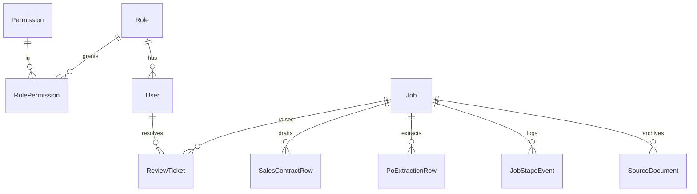

# Data Model

Schema: [`prisma/schema.prisma`](../../prisma/schema.prisma). Dev provider SQLite;
JSON columns stored as `String`, enums as `String` with documented allowed values,
so the schema ports to PostgreSQL unchanged in semantics.

## Entities

| Model | Purpose | Key constraints |
|-------|---------|-----------------|
| `User` / `Role` / `Permission` / `RolePermission` | RBAC | `User.email` unique; `Role.name` unique |
| `Module` | The 9 work areas + status | PK = module key |
| `SourceDocument` | Immutable intake archive | `sha256` **unique** (idempotency) |
| `Job` | Durable job ledger + state machine | indexed `(module,status)`, `businessKey` |
| `JobStageEvent` | Append-only stage transitions | indexed by job |
| `PoExtractionRow` | 22-column PO EXTRACTION (§C.2.1) | per-market grain |
| `SalesContractRow` | Per-contract draft row (§C.2.2) | append-only; `supersedesRowId` |
| `ReviewTicket` | Exception queue | indexed `(module,status)` |
| `AuditEvent` | Append-only audit trail | indexed `(entityType,entityId)`, `createdAt` |
| `ReferenceData` | Configurable enums / mappings | unique `(type,code)` |
| `IntegrationAdapter` | Adapter registry + health | PK = adapter key |

## Integrity rules enforced in code

- **Append-only:** `SalesContractRow`, `JobStageEvent`, `AuditEvent` are insert-only;
  corrections are new rows (`supersedesRowId`), never updates (BR-SC-21).
- **Idempotency:** intake computes a content hash → `SourceDocument.sha256` unique
  constraint prevents duplicate processing (SC-FR-016).
- **Numeric precision:** quantities are integers; prices/values are stored as floats
  in dev SQLite and should be `NUMERIC(14,2)` in Postgres (see migration notes).
- **Timestamps:** stored UTC; displayed ISO. Date *values* from documents are kept as
  normalised `yyyy-mm-dd` strings to preserve the source's calendar semantics.

## Postgres migration notes

- Switch `datasource.provider` to `postgresql`, set `DATABASE_URL`.
- Convert money columns to `Decimal @db.Decimal(14,2)`.
- Add DB-level advisory locks per `businessKey` for cross-worker concurrency (SC-NFR-06).
- Enforce WORM/retention on archive storage externally (object-lock); audit retention ≥ 7y.
