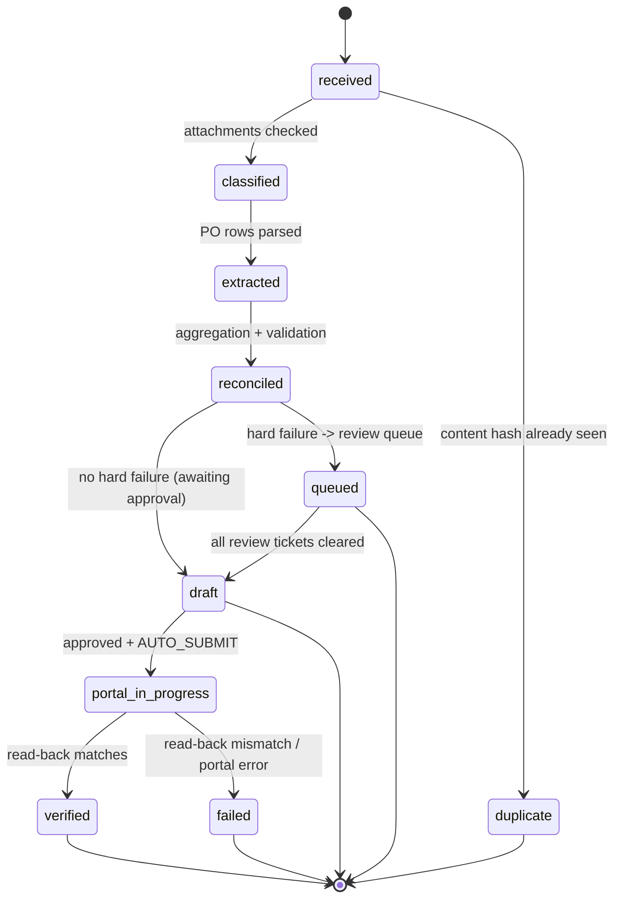

# Job State Machines

Each job carries a `status` and an append-only `JobStageEvent` history (SRS §5.7).

## Sales Contract order-package job

## Transition rules

| From → To | Guard |
|-----------|-------|
| received → duplicate | `SourceDocument.sha256` already present (SC-FR-016) |
| classified → … | all three expected PDFs present, else a `MISSING_PDF` ticket → queued |
| reconciled → queued | any **hard** issue (invalid required field, missing PDF, schema drift) |
| reconciled → draft | only `pending` issues (business decisions) or none |
| draft → portal_in_progress | human approval **and** `AUTO_SUBMIT=true` (default false) |
| portal_in_progress → verified | adapter read-back diff is empty (§7.4) |
| queued → draft | all open `ReviewTicket`s resolved/rejected |

## Invariants

- No destination (contract-row persist + UCP) write occurs for a `queued` job
  (BR-SC-27).
- A job never auto-advances to `portal_in_progress` while `AUTO_SUBMIT=false`.
- Every transition writes a `JobStageEvent` and (for status changes) an `AuditEvent`.
- Unknown submission status does **not** trigger blind retry; it requires a destination
  query before re-attempt (§7.5) — implemented as a fail-closed `failed`/review path.
