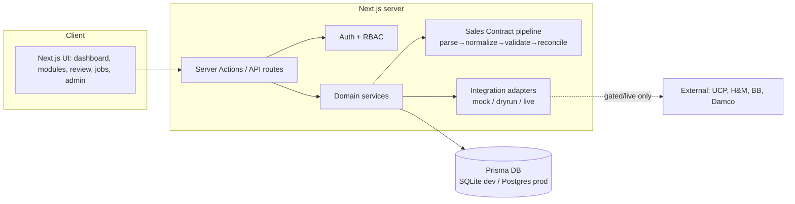

# System Architecture

## Overview

The Ananta Universal Commercial Portal (AUCP) is a **modular monolith** built on
Next.js (App Router) + TypeScript, with a Prisma data layer. The Sales Contract
reconciliation logic is a set of **pure, deterministic modules** invoked from an
intake service — the same code a standalone worker would run (SRS §E).

## Layered responsibilities

| Layer | Location | Responsibility |
|-------|----------|----------------|
| UI | `src/app/(portal)/**` | Server components reading persisted data; no fake metrics |
| Actions | `src/app/actions/**` | Mutations with server-side permission checks |
| Auth | `src/lib/auth.ts`, `permissions.ts` | Sessions (JWT cookie), RBAC |
| Domain (pure) | `src/server/sales-contract/{parse,normalize,validate,reconcile,pipeline}.ts` | Deterministic, side-effect-free business logic |
| Intake service | `src/server/sales-contract/intake.ts` | Persistence, idempotency, job ledger, audit |
| Adapters | `src/server/integrations/**` | External destinations behind one interface; live fails closed |
| Data | `prisma/**`, `src/lib/db.ts` | Schema, migrations, client |

## Separation of concerns (SRS §14)

Extraction (`parse`) never performs side effects. Normalisation and derived rules
(`normalize`, `reconcile`) are deterministic. Only the intake service writes to the
database, and only adapters contact external systems. This mirrors the SRS five-module
worker (M1 Intake, M2 Classifier, M3 Extractor, M4 Reconciler, M5 Portal) collapsed
into one deployable unit while keeping the boundaries intact.

See [ADR-0001](./architecture-decisions/ADR-0001-stack.md) for why this differs from
the SRS's suggested Next+Nest+Postgres+Python split.
