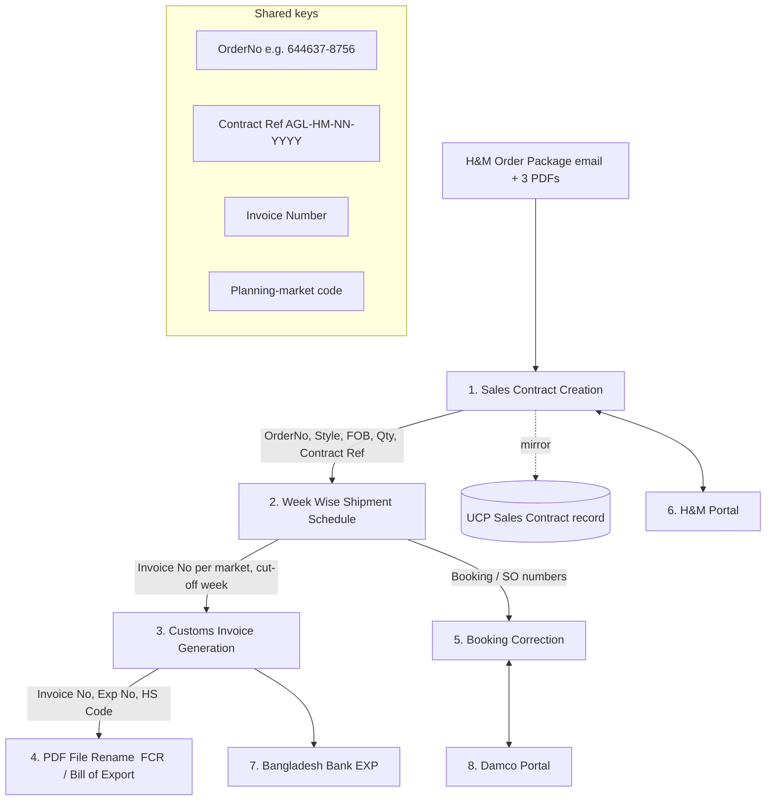

# Cross-Module Workflow Map

How the commercial objects flow between modules. Derived from shared identifiers
observed across sources (OrderNo, Contract Ref `AGL/H&M/<NN>/<YYYY>`, Invoice Number,
Export/EXP Number, Buyer Code, planning-market codes).

## System of record (per field group)

| Object | System of record | Consumers |
|--------|------------------|-----------|
| PO data (qty, FOB, markets, TOD) | H&M Purchase Order PDF | Sales Contract, Shipment Schedule, Customs Invoice |
| Sales Contract row (block/commercial ref, Buyer Code) | AGL Sales Contract workbook / UCP | Shipment Schedule, Customs Invoice, Booking |
| Shipment week + invoice number per market | Week schedule workbook | Customs Invoice, PDF Rename |
| Customs invoice + Exp/HS data | Customs invoice workbook + Bill of Export | PDF Rename, Bangladesh Bank |
| Booking / SO number | Damco portal | Booking Correction |

## Ordering & gating rules

1. **Shipment schedule** requires a confirmed **Sales Contract** (needs OrderNo +
   Contract Ref + FOB). Downstream must not start if the contract row is unverified.
2. **Customs invoice** requires an allocated **invoice number** from the shipment
   schedule and the contract value.
3. **PDF rename** (FCR / Bill of Export) requires the **invoice/export numbers**
   produced upstream.
4. **Booking correction** requires an existing **Damco booking** to correct.

The portal enforces this today only within the Sales Contract module; cross-module
gating is specified here and scheduled per module.
